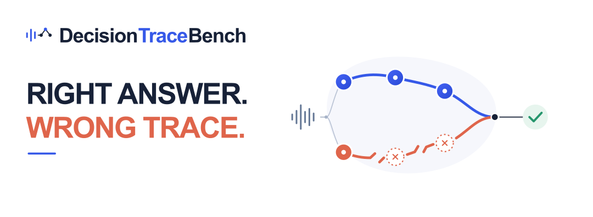

# DecisionTraceBench



DecisionTraceBench 是面向多人对话中决策关键信息跟踪的语音评测基准。它以中文金融对话为场景，评估信息从提出、修订、暂停到定案的完整过程，以及对应的说话人归属、业务作用域和时间证据。基准通过结构化轨迹标注、任务提示词和评测脚本，为学术界与产业界开展可追溯语音理解研究提供共同的评测基础。

🤗 [Hugging Face](https://huggingface.co/datasets/QFIN/DecisionTraceBench)   |   🌐 [English](README.md)

决策关键信息状态跟踪（Decision-Critical Information State Tracking，DCIST）评估模型从多人对话中恢复完整决策状态轨迹的能力。轨迹匹配要求事件序列、动作、说话人归属、作用域、值和时间证据均满足评测要求。

数据在 Hugging Face 独立分发，实际可用内容以数据仓库文件列表为准。已准备的人工录音子集含 26 份录音（8.61 小时）、308 条轨迹和 562 个事件，不含转写文本及论文中的合成子集。

## 功能

- 有序事件对齐与轨迹一对一匹配。
- 周期、前驱关系及定案约束校验。
- 结构化金额等价换算。
- 可配置的时间证据匹配。
- 语义等价映射与额外节点裁定接入。
- 通过自定义模型接口自动生成同义及免罚裁定。
- 单样本评分与按录音宏平均汇总。

## 环境要求

Python **3.10 及以上**，仅依赖 Python 标准库。以下命令使用 [uv](https://docs.astral.sh/uv/)。

在仓库根目录运行测试：

```sh
uv run --no-project python -B -m unittest discover -s tests -v
```

请勿使用 `python -O`，以保留输入校验所需的断言。

## 快速开始

### 单样本评分

使用 `raw` 模式进行精确匹配，包含金额等价归一化：

```sh
uv run --no-project python -m decisiontracebench score --mode raw --gold assets/examples/gold.json --prediction assets/examples/prediction.json --time on
```

使用 `reviewed` 模式应用语义对应关系和额外节点裁定：

```sh
uv run --no-project python -m decisiontracebench score --mode reviewed --gold assets/examples/gold.json --prediction assets/examples/prediction.json --reviews assets/examples/reviews.json --time on
```

示例演示语义等价和额外轨迹免罚对计分的影响：原始 F1 为 `0`，审核后 F1 为 `1`，免罚额外节点比例为 `1/3`。

### 批量评分

```sh
uv run --no-project python -m decisiontracebench score --mode reviewed --manifest assets/examples/manifest.json --output results/example.json
```

清单中的相对路径以清单所在目录为基准。每个样本须有唯一 ID，同一批次采用一致的时间评测设置。

### 使用合并输入

也可以将金标、预测、评测设置和裁定记录放在同一个文件中：

```sh
uv run --no-project python -m decisiontracebench score --mode reviewed --case assets/examples/case.json
```

## 自动同义复核与额外节点裁定

如需自动生成裁定，先准备包含预测、GT、生成 Query 和原文证据的审核清单：

```sh
uv run --no-project python -m decisiontracebench judge prepare --manifest assets/examples/judge_manifest.json --run-dir runs/example
```

此步骤不调用接口。将 `assets/configs/judge_config.example.json` 复制为 `assets/configs/judge_config.json`，填写自己的 `api_key`、`base_url` 和 `model`，然后运行：

```sh
uv run --no-project python -m decisiontracebench judge run --run-dir runs/example --config assets/configs/judge_config.json --workers 4 --max-requests 100
```

运行时会将准备好的证据发送给所配置的服务，可能产生接口费用。流程依次进行字段对应、作用域与值的同义复核、额外节点裁定，最后由脚本计算 DCIST。支持并发和请求数上限；续跑复用成功请求，失败或未完整返回的请求需显式重试，未审核项不会自动免罚。

完整 Query、输入要求、配置和续跑方法见 [自动审核说明](docs/AUTO_REVIEW.md)。

自动流程使用一个配置的裁定模型，不自动执行论文中的第二模型顺序复核和分歧人工定案。复现论文分数需要对应的固定样本集、预测及最终裁定记录；重新运行裁定会产生新的判断。

## 输入格式

金标与预测采用相同的 JSON 结构：

```text
tracks
  entity_id, field_id
  cycles
    cycle_id
    events
      event_id, source_event_id
      action, speaker_id, scope_id, value
      start_ms, end_ms
      result（settle 事件使用）
```

动作包括 `start`、`advance`、`hold` 和 `settle`。裁定记录中的事件索引从 0 开始。`--prediction` 支持 JSON 答案，也支持以文本文件保存的完整原始答案。

批量清单示例：

```json
{
  "samples": [
    {
      "sample_id": "sample_001",
      "gold": "gold.json",
      "prediction": "prediction.json",
      "reviews": "reviews.json",
      "time_enabled": true,
      "inference_status": "completed"
    }
  ]
}
```

`reviews` 在 `reviewed` 模式下按需提供，`raw` 模式不填写。字段定义、判定标签及完整示例见 [输入与裁定格式](docs/FORMAT.md)。

## 评分方法

对每份录音，记金标轨迹数为 `G`，预测轨迹数为 `P`，整体免罚且未匹配金标的轨迹数为 `L`，完整匹配数为 `TP`：

```text
F1 = 2 × TP / (G + P − L)
DCIST (%) = 100 × mean(每份录音的 F1)
```

DCIST 按录音进行宏平均。每条必需轨迹需要完整恢复，仅匹配最终值不足以构成完整轨迹匹配。

| 设置 | 行为 |
|---|---|
| `--mode raw` | 按 JSON 类型精确匹配，并应用金额等价规则；不应用语义映射或额外节点免罚。 |
| `--mode reviewed` | 应用外部提供的、绑定具体位置的语义映射和节点/轨迹裁定。 |
| `--time on` | 时间交集长度除以预测区间长度须至少为 80%。 |
| `--time off` | 评测不要求时间定位的条件，其他匹配要求保持有效。 |

金额归一化将 `{"number":"50000","unit":"元"}` 与 `{"number":"5","unit":"万元"}` 等结构化表达视为等价。语义映射可覆盖字段指称、作用域及值的表达，由外部裁定记录提供并绑定到具体事件；评分器负责校验和应用这些记录。

完整规则见 [评分协议](docs/SCORING.md)。

## 输出

输出 JSON 包含 `summary` 和 `samples`：

| 字段 | 含义 |
|---|---|
| `summary.dcist_percent` | 按录音宏平均的分数，范围 0–100。 |
| `summary.recording_macro_f1` | 对应的 F1，范围 0–1。 |
| `summary.tp` | 完整匹配的轨迹总数。 |
| `samples[].score` | 各样本的计数、精确率、召回率和 F1。 |
| `samples[].details` | 匹配及裁定诊断信息。 |

`reviewed` 模式下，缺少必要裁定时返回 `review_required`，最终分数为 `null`。已完成但格式错误的答案计零并单列数量。无答案的显式处理方式见 [格式说明](docs/FORMAT.md)。

退出码 `0` 表示评分完成，`2` 表示输入错误或仍需裁定。评分器保留输入文件，且不覆盖已有输出。

## 目录结构

```text
decisiontracebench/  Python package and module CLI
assets/
  configs/          Configuration templates
  examples/         Runnable fictional examples
  prompts/          Task and adjudication prompts
docs/               Scoring protocol and file formats
tests/              Offline regression tests
```

## Python 评分库

命令行入口统一为 `python -m decisiontracebench score` 和 `python -m decisiontracebench judge`。Python 调用方可直接使用 `decisiontracebench.scoring.score_case` 和 `aggregate`。包内按职责划分为 `evaluation`（裁定校验）、`matching`（有序对齐与轨迹匹配）、`schema`/`structure`（格式与结构）、`money`/`quantities`/`timing`（金额、数量及时间约束），以及 `judge_client`/`judge_pipeline`（裁定服务与流程）。`historical_reviews` 用于读取历史候选目录，与当前 CLI 流程分开。

## 引用

使用本代码时，请引用论文 **DecisionTraceBench: Tracking Decision-Critical Information in Multi-Party Spoken Conversations**。

## 许可证

本仓库的代码、提示词和说明文档采用 [知识共享署名—非商业性使用 4.0 国际许可协议（CC BY-NC 4.0）](LICENSE)。

独立分发的人工录音和合成子集同样采用 CC BY-NC 4.0；第三方声音资源仍须遵循其来源许可。
